<div align="center">



<br /><br />


<a href="https://www.linkedin.com/in/sina-baradaran/"></a>
<a href="mailto:sinabaradaran01@gmail.com"></a>
<a href="https://heliumpark.ir"></a>
<a href="https://erp.heliumpark.ir"></a>
<a href="https://yekta-group.com"></a>


</div>

---

```console
sina@mashhad:~$ whoami --verbose

  name      Sina Baradaran
  role      Software Developer
  at        Yekta Group · Mashhad, Iran
  since     2022
  owns      the frontend of two live platforms
  also      writes the API when the API is what's in the way

sina@mashhad:~$ _
```

---

### `$ cat stack.json`

<div align="center">
  
  
  
</div>

<details>
<summary><code>$ cat stack.json --full</code></summary>

<br />

| | |
|---|---|
| **Languages** | TypeScript, JavaScript (ES6+), HTML5, CSS3, SQL / T-SQL, C# |
| **Frontend** | React 19, Next.js (App Router, RSC, Server Actions), Vue 3, Nuxt 3, React Router, PWA / Workbox |
| **Forms & validation** | React Hook Form, Formik, Zod, Yup |
| **State & data** | TanStack Query, Redux, Redux Toolkit, Pinia, Vuex, GraphQL, REST, Axios |
| **Styling** | Tailwind CSS v4, SCSS (7-1), CSS Modules, styled-components, PostCSS, CVA |
| **Components** | shadcn/ui, HeroUI, Chakra UI, MUI, CoreUI, Bootstrap, Quasar, Vuetify, Radix |
| **Motion** | Framer Motion, GSAP, Embla Carousel, Swiper |
| **Data & viz** | TanStack Table, ApexCharts, Chart.js, XLSX export, QR & label printing |
| **Localization** | Persian RTL layouts, Jalali calendars (`date-fns-jalali`, `moment-jalaali`, `jalaali-js`) |
| **Backend** | Node.js, Express, SQL Server + stored procedures, JWT, Argon2, OTP auth, RBAC, SSE, Socket.IO, Multer, Swagger, Winston |
| **Testing** | Jest, Supertest, Testing Library, ESLint, Prettier, Husky, lint-staged |
| **DevOps** | Docker, docker-compose, GitLab CI, PM2, Nginx |
| **AI tooling** | Claude Code, MCP servers, custom agent skills, prompt engineering |

</details>

---

### `$ tree ~/system`

Two public platforms, two internal panels and one API — for an entertainment group
running **four venues across Mashhad and Tehran**.

```text
   customers                                              staff
       │                                                    │
       ▼                                                    ▼
┌──────────────────┐  ┌──────────────────┐   ┌─────────────────────────────┐
│  heliumpark.ir   │  │ yekta-group.com  │   │  Helium Admin · Yekta Panel │
│  Next.js 16      │  │  Next.js 15      │   │  React 19 · CoreUI · HeroUI │
│  React 19 · RSC  │  │  GSAP · Framer   │   │  TanStack Query + Table     │
│  Tailwind v4     │  │  Swiper          │   │  131 screens · 10 role      │
│  TanStack Query  │  │                  │   │  scoped workspaces          │
│                  │  │                  │   │  live: erp.heliumpark.ir    │
└────────┬─────────┘  └────────┬─────────┘   └──────────────┬──────────────┘
         │                     │                            │
         └─────────────────────┴──────────┬─────────────────┘
                                          ▼
                         ┌─────────────────────────────────┐
                         │ Node.js · Express · TypeScript  │
                         │ SQL Server, stored procs only   │
                         │ JWT + OTP · 50-permission RBAC  │
                         │ SSE realtime · Swagger docs     │
                         │ 42 modules · 258 endpoints      │
                         └─────────────────────────────────┘
```

> Every number here is countable from the source. I don't ship figures I can't defend.

---

### `$ ls -la ~/work`

| Project | Stack | Scale |
|---|---|---|
| **[heliumpark.ir](https://heliumpark.ir)** | Next.js 16, React 19, TypeScript, Tailwind v4, TanStack Query, Zod | Booking, VIP membership, events, OTP auth, online payment |
| **[yekta-group.com](https://yekta-group.com)** | Next.js 15, GSAP, Framer Motion, Swiper, Formik | Corporate platform |
| **Helium Admin** | React, CoreUI, Redux, TanStack Query, XLSX, QZ Tray | 76 screens · park operations |
| **[Yekta Panel](https://erp.heliumpark.ir)** | React 19, Tailwind, HeroUI, TanStack Table, ApexCharts | 55 screens · invoicing & reservations |
| **Yekta Task Panel API** | Node.js, Express, TypeScript, SQL Server, SSE, Swagger | 42 modules · 258 endpoints |
| **Admin & Experts CRM** | React, TypeScript, GraphQL | Asiatech |
| **Salon reservation system** | Next.js, Tailwind, shadcn/ui | Asiatech |
| **Headless CMS** | Vue, Vuex | Arzesh Network |
| **Learning Management System** | Vue | Arzesh Network |
| **Nasim Rezvan PWA** | React, PWA, real-time audio | Farawin |
| **Quran App** | React, TypeScript | Farawin |

---

### `$ ls ~/open-source`

| Repo | What it is |
|---|---|
| [**front-end-hand-book**](https://github.com/sina-bre/front-end-hand-book) | A frontend handbook, written in MDX |
| [**next-template-app**](https://github.com/sina-bre/next-template-app) | My opinionated Next.js starting point |
| [**turbo-repo-ecommerce-app**](https://github.com/sina-bre/turbo-repo-ecommerce-app) | Monorepo e-commerce with Turborepo |
| [**daily-package**](https://github.com/sina-bre/daily-package) | Small TypeScript utilities I keep reaching for |
| [**car-trader**](https://github.com/sina-bre/car-trader) | Nuxt 3 + Supabase + Prisma car listings |
| [**I-banck**](https://github.com/sina-bre/I-banck) | Vue 3 banking app — accounts, transactions, charts |
| [**Coachs-app**](https://github.com/sina-bre/Coachs-app) | Vue + Vuex + Vue Router demo |
| [**Food-App**](https://github.com/sina-bre/Food-App) | Next.js food ordering app |
| [**Contacts-Manager-CRUD-Application**](https://github.com/sina-bre/Contacts-Manager-CRUD-Application) | Blazor + C# + EF Core, with unit tests |
| [**Advanced-DOM-bankist**](https://github.com/sina-bre/Advanced-DOM-bankist) | Vanilla JS — advanced DOM & intersection observers |
| [**object_tracking**](https://github.com/sina-bre/object_tracking) | Computer vision experiment, Jupyter |
| [**CleanCode**](https://github.com/sina-bre/CleanCode) | Clean code questions & notes |

---

### `$ cat .claude/skills/*`

Beyond shipping features: **encoding how a codebase should be extended, so the standard
survives me.** Seven custom agent skills turn our team conventions into executable
checklists — a new module now arrives with its stored procedures, permission seeds,
workspace scoping and route registration already correct, whether a teammate or an agent
writes it.

```text
.claude/skills/
├── new-module/          types → Zod → repo → service → controller → routes → SQL
├── api-endpoint/        validation, permission, controller, Swagger, tests
├── stored-procedure/    naming, idempotency, workspace scoping, paging contract
├── query-performance/   execution plans, index design, keyset paging
├── tenant-audit/        multi-tenant isolation + RBAC hole detection
├── perf-triage/         isolate the layer before optimising anything
└── api-performance/     N+1, pool saturation, caching, SSE fan-out
```

---

### `$ ./notes --production`

Four things this system taught me that no tutorial did.

```text
[01]  RTL is not a CSS property.
      dir="rtl" flips text — then charts render backwards, carousels swipe the
      wrong way and date pickers stay silently Gregorian. Persian apps need a
      Jalali calendar layer and a mirrored interaction model, not a flag.

[02]  SSE beat WebSockets for us.
      Updates only ever flowed server → client. Server-sent events gave us that
      over plain HTTP with native reconnection and no proxy fights — a fraction
      of the cost of a socket layer we'd never fully use.

[03]  Stored procedures over an ORM.
      No ORM means the data contract lives in SQL, where paging, workspace
      scoping and permission filters are auditable in one place — and a tenant
      isolation bug can't hide behind a query builder.

[04]  Ten navigations beat one.
      A single nav guarded by 93 permission checks is unreadable. Ten role-scoped
      navigations — cashier, coffee shop, accounting, support, IT, reporting —
      made the panel comprehensible to the people actually using it.
```

---

### `$ gh api /users/sina-bre/stats`

<div align="center">
  
  
  
</div>

---

```console
sina@mashhad:~$ contact --open-to-work

  email     sinabaradaran01@gmail.com
  linkedin  linkedin.com/in/sina-baradaran
  status    open to interesting engineering work

sina@mashhad:~$ _
```
