<div align="center">

<a href="https://dev.sinabaradaran01.workers.dev"><picture><source media="(prefers-color-scheme: dark)" srcset="./assets/banner-dark.svg" /><source media="(prefers-color-scheme: light)" srcset="./assets/banner-light.svg" /></picture></a>

<br /><br />

<a href="https://dev.sinabaradaran01.workers.dev"><picture><source media="(prefers-color-scheme: dark)" srcset="https://img.shields.io/badge/portfolio-dev.sinabaradaran01.workers.dev-131315?style=flat-square&logo=cloudflare&logoColor=FF5B2E&labelColor=0B0B0C&color=131315" /><source media="(prefers-color-scheme: light)" srcset="https://img.shields.io/badge/portfolio-dev.sinabaradaran01.workers.dev-FAF8F4?style=flat-square&logo=cloudflare&logoColor=E8461B&labelColor=F0ECE4&color=FAF8F4" /></picture></a>
<a href="https://www.linkedin.com/in/sina-baradaran/"><picture><source media="(prefers-color-scheme: dark)" srcset="https://img.shields.io/badge/linkedin-sina--baradaran-131315?style=flat-square&logo=linkedin&logoColor=FF5B2E&labelColor=0B0B0C&color=131315" /><source media="(prefers-color-scheme: light)" srcset="https://img.shields.io/badge/linkedin-sina--baradaran-FAF8F4?style=flat-square&logo=linkedin&logoColor=E8461B&labelColor=F0ECE4&color=FAF8F4" /></picture></a>
<a href="mailto:sinabaradaran01@gmail.com"><picture><source media="(prefers-color-scheme: dark)" srcset="https://img.shields.io/badge/email-sinabaradaran01-131315?style=flat-square&logo=gmail&logoColor=FF5B2E&labelColor=0B0B0C&color=131315" /><source media="(prefers-color-scheme: light)" srcset="https://img.shields.io/badge/email-sinabaradaran01-FAF8F4?style=flat-square&logo=gmail&logoColor=E8461B&labelColor=F0ECE4&color=FAF8F4" /></picture></a>
<a href="https://dev.sinabaradaran01.workers.dev/sina-baradaran-resume.pdf"><picture><source media="(prefers-color-scheme: dark)" srcset="https://img.shields.io/badge/resume-pdf-131315?style=flat-square&logo=readthedocs&logoColor=FF5B2E&labelColor=0B0B0C&color=131315" /><source media="(prefers-color-scheme: light)" srcset="https://img.shields.io/badge/resume-pdf-FAF8F4?style=flat-square&logo=readthedocs&logoColor=E8461B&labelColor=F0ECE4&color=FAF8F4" /></picture></a>


<br /><br />


</div>

---

### `$ cat about.ts`

```ts
const sina = {
  name: 'Sina Baradaran',
  role: 'Front-End Developer',
  company: 'Yekta Group',
  location: 'Mashhad, Iran',
  experience: '3+ years in production',
  focus: ['React', 'Next.js', 'TypeScript', 'Tailwind CSS'],
  alsoWrites: ['Node.js', 'Express', 'SQL Server'], // when the API is what's in the way
  studying: 'MSc in Software Engineering',
  portfolio: 'https://dev.sinabaradaran01.workers.dev',
} as const satisfies Developer
```

---

### `$ cat stack.json`

<div align="center">
  <picture><source media="(prefers-color-scheme: dark)" srcset="https://skillicons.dev/icons?i=ts%2Cjs%2Creact%2Cnextjs%2Ctailwind%2Chtml%2Ccss%2Csass%2Credux%2Cvue%2Cnuxtjs%2Cvite&theme=dark&perline=12" /><source media="(prefers-color-scheme: light)" srcset="https://skillicons.dev/icons?i=ts%2Cjs%2Creact%2Cnextjs%2Ctailwind%2Chtml%2Ccss%2Csass%2Credux%2Cvue%2Cnuxtjs%2Cvite&theme=light&perline=12" /></picture>
  <picture><source media="(prefers-color-scheme: dark)" srcset="https://skillicons.dev/icons?i=nodejs%2Cexpress%2Cmssql%2Cgraphql%2Cprisma%2Csupabase%2Cdocker%2Cnginx%2Cjest%2Cwebpack%2Cbabel%2Cpnpm&theme=dark&perline=12" /><source media="(prefers-color-scheme: light)" srcset="https://skillicons.dev/icons?i=nodejs%2Cexpress%2Cmssql%2Cgraphql%2Cprisma%2Csupabase%2Cdocker%2Cnginx%2Cjest%2Cwebpack%2Cbabel%2Cpnpm&theme=light&perline=12" /></picture>
  <picture><source media="(prefers-color-scheme: dark)" srcset="https://skillicons.dev/icons?i=git%2Cgithub%2Cgitlab%2Cfigma%2Cpostman%2Cvscode%2Cnpm%2Cmaterialui%2Cbootstrap%2Ccs%2Cdotnet%2Ceslint&theme=dark&perline=12" /><source media="(prefers-color-scheme: light)" srcset="https://skillicons.dev/icons?i=git%2Cgithub%2Cgitlab%2Cfigma%2Cpostman%2Cvscode%2Cnpm%2Cmaterialui%2Cbootstrap%2Ccs%2Cdotnet%2Ceslint&theme=light&perline=12" /></picture>
</div>

<details>
<summary><code>$ cat stack.json --full</code></summary>

<br />

```jsonc
{
  "languages":   ["TypeScript", "JavaScript (ES6+)", "HTML5", "CSS3", "SQL / T-SQL", "C#"],
  "frontend":    ["React 19", "Next.js (App Router, RSC, Server Actions)", "Vue 3", "Nuxt 3", "React Router", "PWA / Workbox"],
  "forms":       ["React Hook Form", "Formik", "Zod", "Yup"],
  "data":        ["TanStack Query", "Redux Toolkit", "Pinia", "Vuex", "GraphQL", "REST", "Axios"],
  "styling":     ["Tailwind CSS v4", "SCSS (7-1)", "CSS Modules", "styled-components", "PostCSS", "CVA"],
  "components":  ["shadcn/ui", "HeroUI", "Radix", "Chakra UI", "MUI", "CoreUI", "Quasar", "Vuetify"],
  "motion":      ["Framer Motion", "GSAP", "Embla Carousel", "Swiper"],
  "dataViz":     ["TanStack Table", "ApexCharts", "Chart.js", "XLSX export", "QR & label printing"],
  "i18n":        ["Persian RTL layouts", "date-fns-jalali", "moment-jalaali", "jalaali-js"],
  "backend":     ["Node.js", "Express", "SQL Server + stored procedures", "JWT", "OTP auth", "RBAC", "SSE", "Socket.IO", "Swagger"],
  "testing":     ["Jest", "Supertest", "Testing Library", "ESLint", "Prettier", "Husky", "lint-staged"],
  "devops":      ["Docker", "docker-compose", "GitLab CI", "PM2", "Nginx", "Cloudflare Workers"],
  "ai":          ["Claude Code", "MCP servers", "custom agent skills"]
}
```

</details>

---

### `$ tree ~/system`

Two public platforms, three internal panels and one API, for an entertainment group
running **four venues across Mashhad and Tehran**.

```text
   customers                                              staff
       │                                                    │
       ▼                                                    ▼
┌──────────────────┐  ┌──────────────────┐   ┌─────────────────────────────┐
│  heliumpark.ir   │  │ yekta-group.com  │   │  Helium Admin · Yekta Panel │
│  Next.js 16      │  │  Next.js 15      │   │  React 19 · CoreUI · HeroUI │
│  React 19 · RSC  │  │  GSAP · Framer   │   │  TanStack Query + Table     │
│  Tailwind v4     │  │  Swiper          │   │  131 screens · 10 role      │
│  TanStack Query  │  │                  │   │  scoped workspaces          │
│                  │  │                  │   │  live: erp.heliumpark.ir    │
│                  │  │                  │   │  Ezi · workspace ERP,       │
│                  │  │                  │   │  archive & messaging        │
└────────┬─────────┘  └────────┬─────────┘   └──────────────┬──────────────┘
         │                     │                            │
         └─────────────────────┴──────────┬─────────────────┘
                                          ▼
                         ┌─────────────────────────────────┐
                         │ Node.js · Express · TypeScript  │
                         │ SQL Server, stored procs only   │
                         │ JWT + OTP · 50-permission RBAC  │
                         │ SSE realtime · Swagger docs     │
                         │ 42 modules · 258 endpoints      │
                         └─────────────────────────────────┘
```

> Every number here is countable from the source. I don't ship figures I can't defend.

---

### `$ curl -I ~/live`

| Address | What it is | Stack |
|---|---|---|
| [**heliumpark.ir**](https://heliumpark.ir) | Booking platform for four entertainment venues | Next.js 16 · React 19 · Tailwind v4 · TanStack Query |
| [**erp.heliumpark.ir**](https://erp.heliumpark.ir) | Yekta Panel, the group ERP: invoicing & reservations | React 19 · HeroUI · TanStack Table · ApexCharts |
| [**yekta-group.com**](https://yekta-group.com) | Corporate platform of Yekta Group | Next.js 15 · GSAP · Framer Motion |
| [**novin.one**](https://novin.one) | Online inquiry platform: 23 banking, vehicle & government services | Next.js 15 · TanStack Query · Zustand · NextAuth |
| [**frontend-handbook**](https://frontend-handbook.sinabaradaran01.workers.dev/fa/react/advanced) | Bilingual frontend interview handbook with live examples | React 19 · Vite · MDX · Tailwind v4 |
| [**dev.sinabaradaran01.workers.dev**](https://dev.sinabaradaran01.workers.dev) | This portfolio | React 19 · TypeScript · Tailwind v4 |

---

### `$ ls -la ~/work`

```console
sina@dev ~ $ ls -la ~/work
drwxr-xr-x  heliumpark.ir          Next.js 16 · React 19 · Tailwind v4 · TanStack Query    booking, VIP, events, OTP, payment
drwxr-xr-x  erp.heliumpark.ir      React 19 · HeroUI · TanStack Table · ApexCharts          Yekta Panel · invoicing & reservations
drwxr-xr-x  yekta-group.com        Next.js 15 · GSAP · Framer Motion · Swiper               corporate platform
drwxr-xr-x  novin.one              Next.js 15 · TanStack Query · Zustand · NextAuth         23 inquiry services · Novin
drwxr-x---  ezi                    React 19 · Vite · TanStack Query · React Virtuoso        workspace ERP · archive & messaging
drwxr-x---  yektafa                Next.js 15 · Radix · Zod · SQL Server                    brand site + its own admin
drwxr-x---  helium-admin           React · CoreUI · Redux · TanStack Query · QZ Tray        76 screens · park operations
drwxr-x---  yekta-task-panel-api   Node.js · Express · TypeScript · SQL Server · SSE        42 modules · 258 endpoints
drwxr-x---  admin-experts-crm      React · TypeScript · GraphQL                             Asiatech
drwxr-x---  salon-reservation      Next.js · Tailwind · shadcn/ui                           Asiatech
drwxr-x---  headless-cms           Vue · Vuex                                               Arzesh Network
drwxr-x---  lms                    Vue                                                      Arzesh Network
drwxr-x---  nasim-rezvan-pwa       React · PWA · real-time audio                            Farawin
drwxr-x---  quran-app              React · TypeScript                                       Farawin
```

<sub>`drwxr-xr-x` is public and live; the rest are internal or client work. Case studies: [dev.sinabaradaran01.workers.dev/works](https://dev.sinabaradaran01.workers.dev/works)</sub>

---

### `$ ls ~/open-source`

| Repo | What it is |
|---|---|
| [**portfolio**](https://github.com/sina-bre/portfolio) | This profile's website: React 19, TypeScript, Tailwind v4, CSS scroll-driven motion |
| [**front-end-hand-book**](https://github.com/sina-bre/front-end-hand-book) | Bilingual (Persian/English) frontend interview handbook in MDX, with live editable examples · [read it](https://frontend-handbook.sinabaradaran01.workers.dev/fa/react/advanced) |
| [**next-template-app**](https://github.com/sina-bre/next-template-app) | My opinionated Next.js starting point |
| [**turbo-repo-ecommerce-app**](https://github.com/sina-bre/turbo-repo-ecommerce-app) | Monorepo e-commerce with Turborepo |
| [**quran-main-app**](https://github.com/sina-bre/quran-main-app) | Quran reader in React and TypeScript |
| [**daily-package**](https://github.com/sina-bre/daily-package) | Small TypeScript utilities I keep reaching for |
| [**car-trader**](https://github.com/sina-bre/car-trader) | Nuxt 3 + Supabase + Prisma car listings |
| [**I-banck**](https://github.com/sina-bre/I-banck) | Vue 3 banking app: accounts, transactions, charts |
| [**Food-App**](https://github.com/sina-bre/Food-App) | Next.js food ordering app |
| [**Contacts-Manager-CRUD-Application**](https://github.com/sina-bre/Contacts-Manager-CRUD-Application) | Blazor + C# + EF Core, with unit tests |
| [**Advanced-DOM-bankist**](https://github.com/sina-bre/Advanced-DOM-bankist) | Vanilla JS: advanced DOM & intersection observers |
| [**CleanCode**](https://github.com/sina-bre/CleanCode) | Clean code questions & notes |

---

### `$ cat .claude/skills/*`

Beyond shipping features: **encoding how a codebase should be extended, so the standard
survives me.** Seven custom agent skills turn our team conventions into executable
checklists. A new module now arrives with its stored procedures, permission seeds,
workspace scoping and route registration already correct, whether a teammate or an agent
writes it.

```text
.claude/skills/
├── new-module/          types → Zod → repo → service → controller → routes → SQL
├── api-endpoint/        validation, permission, controller, Swagger, tests
├── stored-procedure/    naming, idempotency, workspace scoping, paging contract
├── query-performance/   execution plans, index design, keyset paging
├── tenant-audit/        multi-tenant isolation + RBAC hole detection
├── perf-triage/         isolate the layer before optimising anything
└── api-performance/     N+1, pool saturation, caching, SSE fan-out
```

---

### `$ ./notes --production`

Four things this system taught me that no tutorial did.

```diff
# [01] RTL is not a CSS property.
- dir="rtl" and done.
+ Charts render backwards, carousels swipe the wrong way, date pickers stay
+ silently Gregorian. Persian apps need a Jalali layer and a mirrored
+ interaction model, not a flag.

# [02] SSE beat WebSockets for us.
- A socket layer for realtime.
+ Updates only flowed server → client. Server-sent events gave us that over
+ plain HTTP with native reconnection and no proxy fights.

# [03] Stored procedures over an ORM.
- Let the query builder handle it.
+ The data contract lives in SQL, where paging, workspace scoping and
+ permission filters are auditable in one place.

# [04] Ten navigations beat one.
- One nav guarded by 93 permission checks.
+ Ten role-scoped navigations: cashier, coffee shop, accounting, support, IT,
+ reporting. Comprehensible to the people actually using it.
```

---

### `$ gh api /users/sina-bre --stats`

<div align="center">
  <picture><source media="(prefers-color-scheme: dark)" srcset="https://github-readme-stats.vercel.app/api?username=sina-bre&show_icons=true&hide_border=false&border_color=232326&border_radius=10&bg_color=0B0B0C&title_color=FF5B2E&icon_color=FF5B2E&text_color=F3F0EA&include_all_commits=true&count_private=true" /><source media="(prefers-color-scheme: light)" srcset="https://github-readme-stats.vercel.app/api?username=sina-bre&show_icons=true&hide_border=false&border_color=E2DDD3&border_radius=10&bg_color=FAF8F4&title_color=E8461B&icon_color=E8461B&text_color=141312&include_all_commits=true&count_private=true" /></picture>
  <picture><source media="(prefers-color-scheme: dark)" srcset="https://github-readme-stats.vercel.app/api/top-langs/?username=sina-bre&layout=compact&hide_border=false&border_color=232326&border_radius=10&bg_color=0B0B0C&title_color=FF5B2E&text_color=F3F0EA&langs_count=6&exclude_repo=object_tracking&hide=jupyter%20notebook%2Cmdx%2Chtml%2Ccss%2Cscss&size_weight=0.3&count_weight=0.7" /><source media="(prefers-color-scheme: light)" srcset="https://github-readme-stats.vercel.app/api/top-langs/?username=sina-bre&layout=compact&hide_border=false&border_color=E2DDD3&border_radius=10&bg_color=FAF8F4&title_color=E8461B&text_color=141312&langs_count=6&exclude_repo=object_tracking&hide=jupyter%20notebook%2Cmdx%2Chtml%2Ccss%2Cscss&size_weight=0.3&count_weight=0.7" /></picture>
  <br />
  <picture><source media="(prefers-color-scheme: dark)" srcset="https://streak-stats.demolab.com?user=sina-bre&background=0B0B0C&border=232326&stroke=232326&ring=FF5B2E&fire=FF5B2E&currStreakNum=F3F0EA&sideNums=F3F0EA&currStreakLabel=FF5B2E&sideLabels=8F8B84&dates=55534F&border_radius=10" /><source media="(prefers-color-scheme: light)" srcset="https://streak-stats.demolab.com?user=sina-bre&background=FAF8F4&border=E2DDD3&stroke=E2DDD3&ring=E8461B&fire=E8461B&currStreakNum=141312&sideNums=141312&currStreakLabel=E8461B&sideLabels=6B6760&dates=9A958C&border_radius=10" /></picture>
  <picture><source media="(prefers-color-scheme: dark)" srcset="https://raw.githubusercontent.com/sina-bre/sina-bre/output/snake-dark.svg" /><source media="(prefers-color-scheme: light)" srcset="https://raw.githubusercontent.com/sina-bre/sina-bre/output/snake.svg" /></picture>
</div>

---

```console
sina@dev ~ $ contact --open-to-work

  portfolio  https://dev.sinabaradaran01.workers.dev
  handbook   https://frontend-handbook.sinabaradaran01.workers.dev
  email      sinabaradaran01@gmail.com
  linkedin   linkedin.com/in/sina-baradaran
  status     open to interesting engineering work

sina@dev ~ $ █
```
